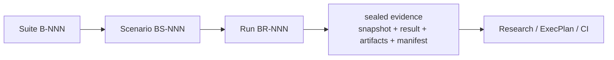

# Engineering Benchmarks

This file is the repository entry point and rebuildable index for reproducible
Benchmark evidence.

## How to read this index

- A Suite (`B-NNN`) defines a long-lived measurement subject, accountable
  owner, safety boundary, and expected consumers.
- A Scenario (`BS-NNN`) predeclares one reusable protocol and decision rule
  before results are visible.
- A Run (`BR-NNN`) records one execution against immutable subject and harness
  revisions. Its sealed bundle contains the Scenario snapshot, Result,
  artifacts, and Evidence Manifest.
- Existing load-test scripts remain in the normal source tree. A Scenario names
  their executable entrypoint; the Run records the exact harness revision.
- Research may interpret several sealed Runs. An ExecPlan declares Scenario IDs
  as independent completion gates. CI and Runbooks may repeat stable Scenarios.
- The managed tables below are projections. Rebuild them with
  `benchctl reindex`; edit Suite, Scenario, and Result facts instead.

## Suites

| ID | Status | Title | Owner | Scenarios | Runs | Path |
|---|---|---|---|---:|---:|---|
| [B-001](suites/b-001_spec-activation-correctness/BENCHMARK.md) | active | Spec activation correctness baseline | RepoFoundry Maintainer | 1 | 2 | `suites/b-001_spec-activation-correctness/BENCHMARK.md` |

## Scenarios

| ID | Suite | Status | Title | Runs | Path |
|---|---|---|---|---:|---|
| [BS-001](suites/b-001_spec-activation-correctness/scenarios/bs-001_readonly-candidate-baseline.md) | B-001 | active | Read-only candidate retrieval and scope baseline | 2 | `suites/b-001_spec-activation-correctness/scenarios/bs-001_readonly-candidate-baseline.md` |

## Runs

| ID | Scenario | Status | Outcome | Subject revision | Supersedes | Path |
|---|---|---|---|---|---|---|
| [BR-001](suites/b-001_spec-activation-correctness/runs/br-001_readonly-main-4c569127/RESULT.md) | BS-001 | sealed | errored | git:4c56912785f498232c69722bd6327b92aaed4a04 | — | `suites/b-001_spec-activation-correctness/runs/br-001_readonly-main-4c569127/RESULT.md` |
| [BR-002](suites/b-001_spec-activation-correctness/runs/br-002_readonly-main-complete/RESULT.md) | BS-001 | sealed | inconclusive | git:4c56912785f498232c69722bd6327b92aaed4a04 | BR-001 | `suites/b-001_spec-activation-correctness/runs/br-002_readonly-main-complete/RESULT.md` |
